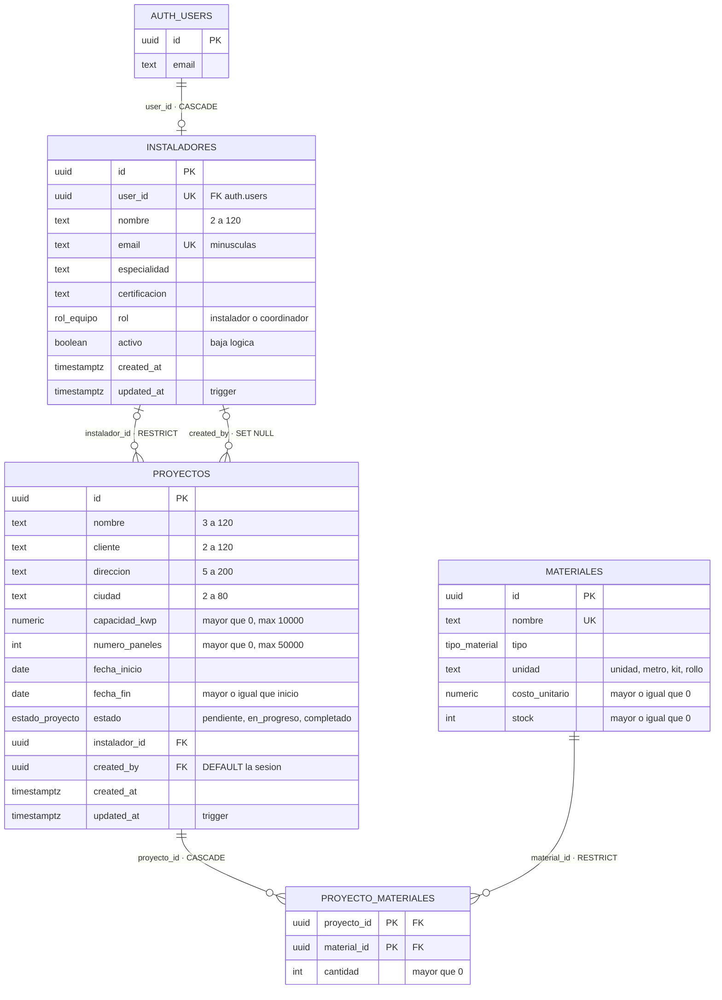
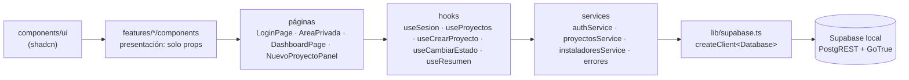
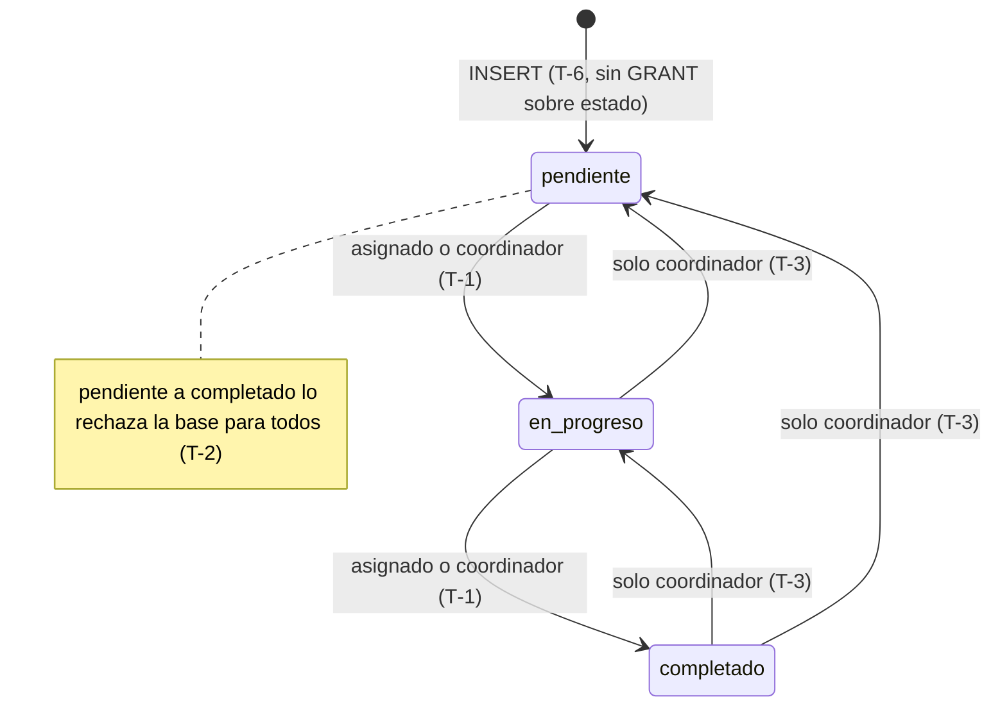
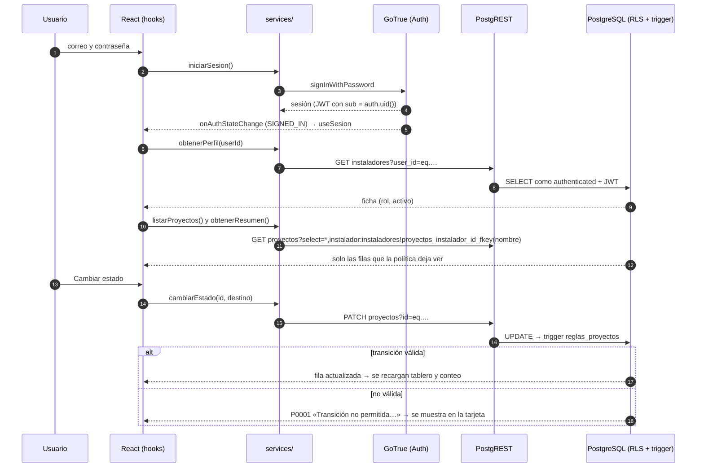

# Documento de Arquitectura — EcoFlow

**Plataforma interna de gestión de proyectos de energía solar**

Proyecto Final Integrador «El Arquitecto IA» · Desarrollo asistido por IA (ingeniería de prompts), módulo 6

**Autor:** Josué David Hernández Martínez

**Fecha:** 18 de noviembre de 2026

**Repositorio:** https://github.com/Josuehmz/ecoflow-energias-renovables

---

## 1. Resumen

EcoFlow es una aplicación interna para que una startup de tecnología limpia gestione sus obras de
instalación de paneles solares. Hay dos perfiles: el **coordinador**, que ve y administra todo, y el
**instalador**, que solo ve los proyectos que tiene asignados y avanza su estado.

| Capa | Tecnología |
|---|---|
| Base de datos, Auth y API | Supabase **local** (CLI 2.122.0 + Docker): PostgreSQL 17, GoTrue, PostgREST, Studio |
| Frontend | Vite 8 + React 19 + TypeScript 7 estricto, Tailwind 4, shadcn/ui (radix-nova) |
| Formularios | react-hook-form 7 + zod 4 |
| Pruebas | pgTAP (`supabase test db`), supabase-js con sesiones reales, Vitest 5 + Testing Library |

El método fue **especificación primero**: el documento [ESPECIFICACION-TECNICA.md](ESPECIFICACION-TECNICA.md)
(el prompt maestro) y las pruebas de aceptación de la base se escribieron **antes** que el SQL y el
código, y cada respuesta de la IA se midió contra ellas ([PROMPTS.md](PROMPTS.md)).

## 2. Diagrama de la base de datos



Lo mismo en texto (para quien no renderiza Mermaid):

- `auth.users` 1 — 0..1 `instaladores` (`user_id` UNIQUE, ON DELETE CASCADE).
- `instaladores` 0..1 — N `proyectos` por `instalador_id` (ON DELETE RESTRICT) y por `created_by`
  (ON DELETE SET NULL).
- `proyectos` N — M `materiales` a través de `proyecto_materiales` (PK compuesta
  `(proyecto_id, material_id)`; CASCADE desde el proyecto, RESTRICT desde el material).
- Vista `resumen_proyectos_por_estado(estado, total)` sobre `proyectos`, con `security_invoker`.

El SQL completo es una sola migración versionada:
[supabase/migrations/20261119025015_esquema_ecoflow.sql](../supabase/migrations/20261119025015_esquema_ecoflow.sql)
(640 líneas). La semilla está en [supabase/seed.sql](../supabase/seed.sql).

## 3. Estructura del repositorio

```text
ecoflow-energias-renovables/
├── docs/
│   ├── ESPECIFICACION-TECNICA.md     ← prompt maestro (escrito antes del código; v1.0 → 1.4)
│   ├── ARQUITECTURA.md / .pdf        ← este documento
│   ├── PROMPTS.md                    ← los 5 prompts, v1 → v5, qué falló y cómo se corrigió
│   ├── CASO-IA-PROBLEMA-COMPLEJO.md  ← un fallo real de la IA, con la prueba que lo destapó
│   ├── img/                          ← diagramas renderizados (SVG y PNG)
│   └── evidencia/                    ← salidas crudas: CLI, pgTAP, API, front
├── supabase/
│   ├── config.toml                   ← registro público desactivado, contraseña mínima 10
│   ├── migrations/…_esquema_ecoflow.sql  ← tipos, tablas, triggers, vista, grants y RLS
│   ├── seed.sql                      ← 4 usuarios de Auth, personal, 9 proyectos, 6 materiales
│   └── tests/database/ecoflow_aceptacion.test.sql  ← 67 pruebas pgTAP
├── src/
│   ├── lib/supabase.ts               ← único createClient<Database>; rechaza claves service_role
│   ├── services/                     ← acceso a datos y traducción de errores (únicos que usan lib/)
│   ├── hooks/useConsulta.ts          ← carga genérica: cargando / listo / error / reintentar
│   ├── features/
│   │   ├── auth/                     ← useSesion, usePerfil, login, encabezado
│   │   ├── proyectos/                ← hooks, formulario (zod), tarjeta, cambio de estado
│   │   └── dashboard/                ← resumen por estado y tablero de 3 columnas
│   ├── components/ui/                ← shadcn/ui
│   └── types/                        ← database.types.ts (generado) y dominio.ts (derivado)
├── bitacora/                         ← prompts literales, respuestas sin editar y su verificación
├── herramientas/                     ← scripts de verificación, tipos, PDF y diagramas
└── demo/grabar-demo.ts               ← script Playwright que graba el video
```

### 3.1 Capas del frontend



La flecha es «usa a». La regla se hace cumplir con oxlint (`no-restricted-imports` en
[.oxlintrc.json](../.oxlintrc.json)): un componente o una página que importe `lib/supabase` o un
servicio no pasa el lint. Se probó en negativo:
[docs/evidencia/front/regla-capas-negativa.txt](evidencia/front/regla-capas-negativa.txt). Al
extender la regla a las páginas destapó un import de tipo desde un servicio en `AreaPrivada`, que se
corrigió.

## 4. Base de datos

### 4.1 Tablas y decisiones

| Tabla | Decisión | Por qué |
|---|---|---|
| `instaladores` | Coordinadores y instaladores en la misma tabla, con `rol` | Son personas del equipo; un solo `join` da el nombre del asignado y del creador. Una tabla `coordinadores` aparte duplicaría columnas y FK |
| `instaladores.user_id` | UNIQUE + FK a `auth.users` | Relación 1:1 con la cuenta: la RLS identifica a la persona por `auth.uid()` |
| `instaladores.activo` | Baja lógica en lugar de borrar | Un instalador con historia no se puede borrar (RESTRICT); se desactiva y deja de ver proyectos (S-4) |
| `proyectos.estado` | ENUM `estado_proyecto` | El orden del enum es el de la máquina de estados; un texto con CHECK no tiene orden |
| `proyectos.capacidad_kwp` | `numeric(8,2)` | Decimales exactos (kWp con 2 decimales), sin errores de coma flotante |
| `proyectos.created_by` | DEFAULT `privado.mi_instalador_id()` y sin GRANT de escritura | Lo pone la base; el cliente no puede falsificar quién creó el proyecto (I-3) |
| `materiales` | Catálogo con `tipo` ENUM y `unidad` con CHECK | El tipo cierra el dominio; la unidad es texto corto validado |
| `proyecto_materiales` | Tabla puente con PK compuesta | Un material aparece una vez por proyecto con su cantidad; la PK evita duplicados |

### 4.2 Claves foráneas y ON DELETE

| FK | ON DELETE | Justificación |
|---|---|---|
| `instaladores.user_id → auth.users.id` | CASCADE | La ficha no tiene sentido sin su cuenta. Si la persona tiene proyectos, la cascada choca con el RESTRICT de abajo y el borrado de la cuenta **falla** (prueba CA-12 de pgTAP): primero se reasigna o se desactiva |
| `proyectos.instalador_id → instaladores.id` | RESTRICT | Borrar a un instalador no debe borrar obras (CASCADE) ni dejarlas sin responsable en silencio (SET NULL rompería el CHECK I-1 de los proyectos en curso). Se usa la baja lógica |
| `proyectos.created_by → instaladores.id` | SET NULL | La autoría es metadato: si se borra a quien creó el proyecto, el proyecto sigue |
| `proyecto_materiales.proyecto_id → proyectos.id` | CASCADE | Las líneas de material pertenecen al proyecto: sin él no significan nada |
| `proyecto_materiales.material_id → materiales.id` | RESTRICT | Un material usado en una obra no desaparece del catálogo; se deja de usar |

### 4.3 Restricciones (CHECK) en la base, no solo en el front

`capacidad_kwp > 0 y <= 10000`, `numero_paneles > 0 y <= 50000`, `fecha_fin >= fecha_inicio`,
longitudes con `char_length(btrim(x))`, email en minúsculas y con forma de correo, `unidad` en lista
cerrada, `costo_unitario >= 0`, `stock >= 0`, `cantidad > 0`, y **I-1**: `estado = 'pendiente' or
instalador_id is not null` (no hay obra en curso sin responsable). El formulario repite estas reglas
con zod para avisar en el campo, pero la base es la autoridad (prueba: CA-11 en pgTAP y
`capacidad 0` por la API).

### 4.4 Índices

| Índice | Para qué |
|---|---|
| `proyectos(instalador_id)` | La política `proyectos_select` del instalador filtra por esta columna; y la FK lo pide para no bloquear borrados en `instaladores` |
| `proyectos(created_by)` | Índice de FK (SET NULL recorre los hijos) |
| `proyectos(estado)` | Conteos y columnas del tablero |
| `proyecto_materiales(material_id)` | Índice de FK (RESTRICT busca hijos al borrar un material) |
| `instaladores(user_id)` | Lo da el UNIQUE; lo usan las funciones auxiliares en cada consulta |
| `proyecto_materiales(proyecto_id)` | Ya es prefijo de la PK compuesta: un índice aparte sería redundante |

### 4.5 Triggers y vista

- `set_updated_at()` (BEFORE UPDATE en las tres tablas con `updated_at`): usa `clock_timestamp()`.
- `privado.reglas_proyectos()` (BEFORE INSERT OR UPDATE en `proyectos`): crear solo coordinador,
  asignación válida (I-2: activo y con rol instalador), «el asignado solo cambia `estado`»
  (compara `to_jsonb(new)` con `to_jsonb(old)` sin `estado` ni `updated_at`) y la máquina de
  estados (§5). Es `security invoker` a propósito: `current_user` dice si la operación viene de un
  usuario (`authenticated`) o de un rol de servicio (semilla, Studio).
- Vista `resumen_proyectos_por_estado`: parte de `unnest(enum_range(null::estado_proyecto))` con
  `left join` a `proyectos`, así siempre hay tres filas aunque un estado tenga cero; `security_invoker
  = true` hace que la vista aplique la RLS de quien consulta (sin eso, una vista de Supabase corre
  como su dueño y un instalador contaría los proyectos de todos).

## 5. Máquina de estados del proyecto



La regla vive **solo en la base** (trigger, SQLSTATE `P0001`, mensaje «Transición no permitida: de
«x» a «y». …»). React no la duplica: `CambioEstado` deja elegir el destino, envía, y si la base lo
rechaza la tarjeta muestra el mensaje tal cual. Así la interfaz no puede contradecir a la base, y el
video lo muestra con el instalador intentando devolver un proyecto a Pendiente.

## 6. Seguridad: privilegios y RLS

### 6.1 Tres capas

1. **Privilegios (GRANT).** En Supabase cada tabla nueva nace con todo concedido a `anon` y
   `authenticated`, y las políticas no lo quitan. La migración hace `revoke all` y concede a
   `authenticated` solo lo necesario, **por columna** en INSERT/UPDATE: nadie con sesión escribe `id`,
   `created_by`, `created_at`, `updated_at` ni (al crear) `estado`; `instaladores.user_id` no se
   actualiza. `anon` no tiene nada: la herramienta es interna.
2. **RLS habilitada y forzada** en las cuatro tablas (`force row level security`), con una política
   por operación y tabla, todas `to authenticated`.
3. **Trigger de reglas** para lo que una política no puede expresar (qué columnas cambió un rol, qué
   transición de estado es válida).

### 6.2 Funciones auxiliares

`privado.es_coordinador()` y `privado.mi_instalador_id()` son `security definer`, `stable`, con
`set search_path = ''` y nombres totalmente calificados:

- `security definer` porque leen `instaladores`, que tiene RLS: si corrieran como el usuario, la
  política de `instaladores` llamaría a `es_coordinador()`, que leería `instaladores`… (recursión).
  Corren como `postgres`, que en Supabase local tiene `BYPASSRLS` (comprobado en `pg_roles`).
- `search_path = ''` para que nadie pueda suplantar una tabla creando un objeto homónimo en otro
  esquema.
- Viven en el esquema `privado`, que PostgREST no expone: no se pueden llamar como RPC.
- Las dos exigen `activo = true`: un instalador dado de baja no es coordinador ni tiene id (S-4).
- En las políticas se escriben `(select privado.es_coordinador())` para que PostgreSQL las evalúe
  una vez por consulta y no una vez por fila.

### 6.3 Políticas

| Tabla | Política | Regla | Justificación |
|---|---|---|---|
| `instaladores` | `instaladores_select` | `user_id = auth.uid()` o coordinador | Cada persona ve su ficha (también inactiva, para que la app explique por qué no ve nada); el coordinador ve al equipo |
| | `_insert`, `_update`, `_delete` | coordinador | Nadie se da de alta ni se cambia el rol a sí mismo (probado: el ascenso de A afecta 0 filas) |
| `proyectos` | `proyectos_select` | coordinador o `instalador_id = mi_instalador_id()` | Requisito central: cada instalador solo ve lo asignado |
| | `proyectos_insert` | coordinador | Planear obras es del coordinador |
| | `proyectos_update` | coordinador o el asignado (USING y WITH CHECK) | El asignado actualiza su obra; WITH CHECK impide que la fila quede fuera de su alcance. Qué columna y qué transición: trigger |
| | `proyectos_delete` | coordinador | |
| `materiales` | `materiales_select` | `true` para `authenticated` | El catálogo no es sensible dentro de la empresa; `anon` no tiene GRANT |
| | `_insert`, `_update`, `_delete` | coordinador | |
| `proyecto_materiales` | `proyecto_materiales_select` | `exists (select 1 from proyectos p where p.id = proyecto_id)` | La subconsulta pasa por la RLS de `proyectos`: «visible si el proyecto es visible», con una sola fuente de la regla. No hay recursión porque `proyectos` no consulta `proyecto_materiales` |
| | `_insert`, `_update`, `_delete` | coordinador | |

### 6.4 Lo que se probó

- **67 pruebas pgTAP** contra el Supabase local (`supabase test db`), en
  [ecoflow_aceptacion.test.sql](../supabase/tests/database/ecoflow_aceptacion.test.sql); salida en
  [verificacion-final.txt](evidencia/rls/verificacion-final.txt). Cubren anon, instalador A, B,
  coordinadora e inactivo; CHECK, FK, índices, `security definer`, transiciones y la vista.
- **19 comprobaciones por la API real** (GoTrue emite el JWT y la consulta pasa por PostgREST, como
  desde el navegador): [api-sesiones-reales.txt](evidencia/rls/api-sesiones-reales.txt).

## 7. Flujo de datos entre React y Supabase



Detalles que importan:

- `onAuthStateChange` emite `INITIAL_SESSION` al suscribirse con la sesión guardada en
  `localStorage`: `useSesion` arranca en «cargando» y no parpadea el login al recargar.
- `proyectos` tiene **dos** FK a `instaladores`; el embed nombra la restricción
  (`instaladores!proyectos_instalador_id_fkey`) o PostgREST no sabría cuál usar.
- Con RLS, lo que no se puede ver **no da error, da lista vacía**: por eso «vacío» y «error» son
  estados distintos en la interfaz.
- Después de crear o cambiar, `DashboardPage` sube un contador `version` y `useProyectos` y
  `useResumen` recargan.

## 8. Tipos TypeScript

1. `pnpm gen:types` corre `supabase gen types typescript --local` y escribe
   [src/types/database.types.ts](../src/types/database.types.ts); `pnpm gen:types:check` falla si el
   archivo no coincide con el esquema (se corre antes de cada entrega).
2. `createClient<Database>` tipa cada consulta: `select('*, instalador:…(nombre)')` devuelve
   `ProyectoConInstalador[]` sin un solo `as`.
3. [src/types/dominio.ts](../src/types/dominio.ts) deriva los tipos de dominio de `Database`
   (`Proyecto`, `EstadoProyecto`, `NuevoProyecto`…). `NuevoProyecto` **omite** las columnas que el
   generador deja escribir pero la base rechaza por GRANT.
4. El esquema zod del formulario termina con una línea que no compila si su salida deja de ser
   asignable a `NuevoProyecto` (probado con una mutación en
   [bitacora/v3-tipos/verificacion.txt](../bitacora/v3-tipos/verificacion.txt)).

La IA no escribió los tipos «de memoria»: auditó los generados contra el SQL. Esa auditoría
encontró que un proyecto podía **nacer** completado (detalle en [PROMPTS.md](PROMPTS.md#prompt-03)).

## 9. Prompts clave

La historia completa está en [PROMPTS.md](PROMPTS.md); estos son los cinco prompts y lo que dejaron:

| # | Prompt | Resultado medido | Qué corrigió la especificación o la evidencia |
|---|---|---|---|
| 01 | Especificación completa → migración SQL (esquema, RLS, trigger, vista) | 62 de 65 pruebas | `created_by` se sobrescribía en silencio y la semilla quedaba con 9 de 9 en NULL |
| 02 | Corrección citando las 3 pruebas en rojo + especificación 1.2 | 65 de 65 | DEFAULT + GRANT por columna; luego se agregó a mano que `user_id` no se edita (prueba 66) |
| 03 | Auditoría de los tipos generados contra el SQL + dominio + zod | tsc 0; hallazgo T-6 | Un proyecto podía crearse ya completado: se quitó `estado` del GRANT de INSERT (prueba 67) |
| 04 | Frontend por features con arquitectura fija | tsc 0, lint 1 aviso, Vitest 23 de 25 | Dos fallos de prueba y tres problemas visibles solo en capturas reales |
| 05 | Corrección citando la salida literal y las capturas | tsc 0, lint 0, Vitest 28 de 28, build ok | |

Fragmento del prompt 01 (el resto es la especificación adjunta):

```text
Actúa con el rol de la sección 0 de la especificación adjunta.
Tarea: escribe la migración SQL inicial de Supabase (PostgreSQL 17) que implementa las secciones
2, 3 y 4 de la especificación […]
Restricciones:
- Nada que no esté en la especificación (ni tablas, ni columnas, ni roles nuevos).
- En las políticas, envuelve auth.uid() y las funciones auxiliares en (select ...) […]
- Archivo completo, sin fragmentos ni «...». Después del SQL, una lista breve de las decisiones que
  tomaste donde la especificación no era explícita.
```

Fragmento del prompt 02 (cita la salida real de pgTAP, no una opinión):

```text
Probé tu migración con `supabase db reset` + `supabase test db` en el Supabase local. Pasan 62 de
65 pruebas de aceptación. Fallan estas tres (salida literal de pgTAP):
  not ok 4 - I-3 el cliente no puede escribir created_by
  not ok 11 - I-3/T-4 los proyectos de la semilla (rol postgres, sin sesión) conservan created_by
  not ok 46 - I-3 ni la coordinadora puede fijar created_by desde el cliente
```

## 10. Decisiones y alternativas descartadas

| Decisión | Alternativa descartada | Por qué |
|---|---|---|
| Supabase local con la CLI | Proyecto en la nube | Reproducible con `supabase db reset`; sin credenciales que manejar ni cuota que gastar |
| Rol en `instaladores` | Rol en `raw_user_meta_data` del usuario | Los metadatos los escribe el propio usuario en `signUp`: se asignaría el rol él mismo |
| Registro público desactivado (`enable_signup = false`) | Registro con trigger que cree la ficha | Es una herramienta interna: el personal lo da de alta un coordinador |
| Regla de estados en un trigger | Solo en React / en la política RLS | React se puede saltar con una petición directa; una política no ve el valor anterior de la fila |
| Columnas de sistema por GRANT por columna | Sobrescribirlas en el trigger | Sobrescribir en silencio esconde el error (fue la v1 de la IA) y pisaba la semilla |
| `ON DELETE RESTRICT` + baja lógica | CASCADE o SET NULL en `instalador_id` | No se pierden obras ni quedan obras en curso sin responsable |
| Vista con `security_invoker` | Función RPC `security definer` para los conteos | La RPC tendría que reimplementar el filtro de la RLS; la vista la hereda |
| Recarga tras mutación (`version`) | Supabase Realtime | Fuera de alcance (§8 de la especificación); una herramienta interna de pocas personas no lo necesita |
| Tipos generados por la CLI | Tipos escritos por la IA | El generador es exacto para la forma; la IA aporta lo que el generador no sabe (GRANT, trigger, RLS) |

## 11. Cómo reproducir

```bash
supabase start -x realtime,storage-api,imgproxy,edge-runtime,logflare,vector,supavisor,mailpit
supabase db reset          # migración + semilla
supabase test db           # 67 pruebas pgTAP
pnpm install
pnpm gen:types:check       # los tipos coinciden con el esquema
cp .env.example .env.local # y llenar con `supabase status -o env` (API_URL y ANON_KEY)
pnpm typecheck && pnpm lint && pnpm test && pnpm build
pnpm dev                   # http://127.0.0.1:5173 — usuarios en el README
```

## 12. Limitaciones

- No se desplegó en la nube: todo se ejecutó contra el Supabase local.
- No hay pantallas para editar personal, materiales ni consumos (la base y sus políticas sí lo
  permiten al coordinador; se puede hacer desde el Studio).
- La regla de estados devuelve los nombres internos del enum (`en_progreso`) en su mensaje.
- El video no tiene narración de voz: se explica con rótulos en pantalla.
